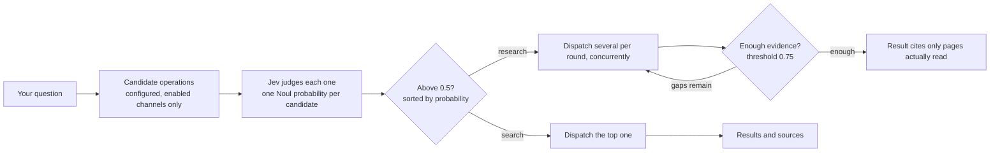

<div align="center">


# Smart Search

### Let your AI search the web, read the original pages, and answer with sources you can check

**You pick the providers and bring the keys. Jev decides which channel each question should go to.**

[简体中文](README.zh-CN.md) | English

[](https://www.npmjs.com/package/@konbakuyomu/smart-search)
[](https://github.com/konbakuyomu/smartsearch/actions/workflows/ci.yml)
[](https://github.com/konbakuyomu/smartsearch/releases/latest)
[](https://nodejs.org/)
[](#supported-ai-tools)
[](https://github.com/konbakuyomu/smartsearch/blob/main/LICENSE)

[Download the App](https://github.com/konbakuyomu/smartsearch/releases/latest) · [User guide](https://github.com/konbakuyomu/smartsearch/tree/main/docs/guide) · [Jev routing](https://github.com/konbakuyomu/smartsearch/blob/main/docs/jev-routing.md) · [Report a problem](https://github.com/konbakuyomu/smartsearch/issues)

[See it](#see-it) · [Quick start](#quick-start) · [Everyday use](#everyday-use) · [How it works](#how-it-works) · [Providers](#capabilities-and-providers) · [Commands](#common-commands) · [FAQ](#faq)

<code>npm install -g @konbakuyomu/smart-search@latest</code>

</div>

<br>

<p align="center">
  
</p>
<p align="center"><sub>The same question, asked with the built-in search (left) and with Smart Search (right): Jev scores every configured channel and dispatches only the highest one above the threshold. The numbers shown are examples. Animations are in Chinese.</sub></p>

> [!IMPORTANT]
> Smart Search does not provide search itself. Searching and page reading are done by the providers you choose, with API keys you supply, saved in your local configuration folder. Provider tests and searches may use those providers' paid quota; opening the App or checking the local environment never runs a paid search.

## What it is

Smart Search puts search, page reading and provider configuration in one place and connects them to AI tools such as Codex, Claude Code and Cursor. It has three parts:

| Part | What it does |
| --- | --- |
| **Independent CLI** (`smart-search`) | Runs searches, page reads and live research; your AI goes online through it |
| **Desktop App** (Windows / macOS) | Installs the CLI, configures providers, updates Skills, searches and shows activity |
| **Skills** | Instructions installed into your AI tools that tell them when and how to call the CLI |

The App only manages; after you close it, your AI keeps calling the CLI as its Skill describes.

It helps when you are:

- **Working with a library or API:** find current documentation and read the relevant pages.
- **Following recent changes:** look up announcements or news newer than a model's knowledge.
- **Checking a claim:** find its source, read the page, and compare it with other evidence.
- **Researching a larger question:** collect sources over several rounds, inspect gaps, and build a cited answer.

## See it

<table>
  <tr>
    <td width="50%" valign="top">
      
      <p><b>Ask your AI</b><br><sub>Say three things: use Smart Search, read the relevant page, give the sources. The AI searches, reads the original page and cites it.</sub></p>
    </td>
    <td width="50%" valign="top">
      
      <p><b>Configure a provider in the App</b><br><sub>Pick a provider, paste its key, test it (one real request), then save.</sub></p>
    </td>
  </tr>
  <tr>
    <td width="50%" valign="top">
      
      <p><b>Search in the App</b><br><sub>On Search &amp; research, pick a tool and enter a question; the result comes with its source links, ready to copy or export.</sub></p>
    </td>
    <td width="50%" valign="top">
      <p><b>The full videos</b></p>
      <sub>The feature film, the setup tutorial and the everyday-use tutorial are <a href="#full-videos">below</a>. All three are rendered frame by frame from code; their sources are in <a href="promo/"><code>promo/</code></a> and can be rebuilt locally.</sub>
      <br><br>
      <sub>Clawd in the animations is an unofficial fan depiction, not affiliated with Anthropic. The App screens are a redrawn illustration of the Windows App, with text taken from its source.</sub>
    </td>
  </tr>
</table>

### Full videos

The captions are in Chinese.

**The feature film, “The Same Question”** (53 s): the same question asked with the built-in search and with Smart Search, side by side: Jev routing, search, reading the original page, and an answer with sources.

https://github.com/user-attachments/assets/8909f8b9-394b-4617-b6bb-3c8b6904efc6

**Setup tutorial** (69 s): the Windows App page by page: install the CLI, add and test an API key, turn on Jev routing, update Skills.

https://github.com/user-attachments/assets/d2b17aea-1abe-4658-808a-1f212649e5e1

**Everyday use** (62 s): ask your AI directly, search and research in the App, read Activity, the common commands, and keep working after closing the App.

https://github.com/user-attachments/assets/915cb409-e012-4aa4-8910-3d213f732386

## Quick start

### With the App (recommended)

1. **Install the App and the CLI.** Download the package for your system from [Releases](https://github.com/konbakuyomu/smartsearch/releases/latest). Step 1 on **Overview** finds npm on your machine (or takes a manual path); **Install CLI** installs and connects the independent CLI. On Windows with a WSL distribution, each environment gets its own button: **Install in Windows** and **Install in WSL &lt;distribution&gt;** (WSL needs Node.js 18 or later).
2. **Configure providers.** On **Providers**, choose one provider each for main search, documentation search and page fetching, enter its API key, click **Test**, then **Save changes**. Each provider has a **Get API key** link. One working retrieval channel is enough to search; with all three, routing has more channels to choose from.
3. **Turn on Jev routing (optional).** Under **Providers → Intent routing**, enter a TypeSafe API key. The router mode defaults to **JEV semantic routing**; without a key, channels are chosen by local rules.
4. **Connect your AI tools.** On **Update Skills**, select your Agents (Codex, Claude Code and Cursor are selected by default) and click **Update selected Skills**. Files that differ are backed up first and extra files are kept. Reopen your Agent session and start asking.

Page-by-page instructions: [Set up and use the App](https://github.com/konbakuyomu/smartsearch/blob/main/docs/guide/en/app.md).

### Terminal only

```sh
npm install -g @konbakuyomu/smart-search@latest
smart-search setup          # terminal wizard; smart-search ui opens a local configuration page instead
smart-search doctor --format json
```

The npm CLI needs only Node.js 18+. Its platform package includes the Python runtime and does not use a user-installed Python. For a uv source installation or a fixed Python version, see [CLI installation](https://github.com/konbakuyomu/smartsearch/blob/main/docs/guide/en/cli.md#cli-installation).

## Everyday use

**In your AI tool:** ask naturally, for example:

> Use Smart Search to find the current React documentation for useEffect cleanup. Read the relevant page and include the source.

> Use Smart Search to check the claims in this page: https://example.com/article

```powershell
smart-search route "React useEffect API docs" --format markdown
smart-search route "请核验这个链接里的说法 https://example.com/source" --format json
```

5. Fetch exact page evidence:

```powershell
smart-search fetch "https://example.com/source" --format markdown --output evidence.md
```

6. Plan Deep Research:

```powershell
smart-search deep "Deep research recent Bitcoin market movement" --budget standard --format json
```

7. Run live Deep Research when you want the CLI to execute the staged workflow:

```powershell
smart-search research "Deep research recent Bitcoin market movement" --budget deep --format markdown
```

8. Install the skill for AI tools when setup prompts you, or explicitly:

```powershell
smart-search setup --non-interactive --install-skills codex,claude,cursor,hermes
```

Skill installation writes the bundled `smart-search-cli` skill into user-level tool directories such as
`~/.codex/skills`, `~/.claude/skills`, `~/.cursor/skills`, and `~/.hermes/skills`. It does not initialize
Trellis, hooks, agents, or commands. `--skills-root PATH` is only an advanced override for portable or test installs.

9. After upgrading the CLI, refresh the installed global skill:

```powershell
smart-search skills status --targets codex --format json
smart-search skills update --targets codex --format json
```

`setup --install-skills` remains available for first-time setup. For routine synchronization after package updates, use
`skills status` and `skills update`; they only inspect or overwrite the managed `smart-search-cli` files and do not change
provider keys or create Trellis/hooks/agents/commands.

## Current Architecture

| Capability | Main commands | Providers | Role |
| --- | --- | --- | --- |
| `main_search` | `search` | xAI Responses, OpenAI-compatible Chat Completions | Broad answer generation and synthesis |
| `docs_search` | `context7-library`, `context7-docs`, `exa-search` | Context7, Exa | Official docs, SDKs, APIs, framework/library evidence |
| `web_search` | `zhipu-search`, `doubao-search`, `zhipu-mcp-search`, intent-routed reinforcement inside `search` | Zhipu Web Search API, Doubao Search, Zhipu Coding Plan MCP, Tavily, Firecrawl | Chinese, domestic, current, domain-filtered, or supplementary web discovery |
| `web_fetch` | `fetch`, `zhipu-mcp-reader` | Tavily, Jina Reader, Zhipu Coding Plan MCP Reader, Firecrawl | Exact URL content extraction for evidence |
| `vertical_search` | `anysearch-domains`, `anysearch-search`, `anysearch-extract`, `anysearch-batch`, `sciverse-catalog`, `sciverse-search`, `sciverse-semantic`, `sciverse-read`, `sciverse-relations` | AnySearch and Sciverse (experimental) | Explicit structured vertical domains; Sciverse covers academic literature search, semantic search, content chunks, and citation relations |
| `site_map` | `map` | Tavily | Site/documentation structure discovery |
| `deep_planner` | `deep` / `dr` | Local planner only | Offline plan generation; no provider call by default |
| `research_executor` | `research` / `rs` | Registered providers by capability | Live staged research: plan, discover, fetch/read, gap check, evidence-only synthesis |

Fallback is same-capability only:

| Capability | Fallback chain |
| --- | --- |
| `main_search` | xAI Responses -> OpenAI-compatible |
| `docs_search` | Context7 when a library subject matches a candidate title/id; Exa after an empty or low-confidence Context7 match, and for official domains, papers, product pages, and trusted-site discovery |
| `web_search` | Doubao Search -> Zhipu Web Search API -> Zhipu Coding Plan MCP `web_search_prime` -> Tavily -> Firecrawl |
| `web_fetch` | Tavily -> Jina Reader with `JINA_API_KEY` -> Zhipu Coding Plan MCP `webReader` -> Firecrawl |

**In the App:** open **Search & research**, choose a tool (Search, Read page, Live research and more), enter a question or URL, and read the result and its **Source links** on the right; copy or export it. **Activity** shows each task's status, phase and provider, including tasks your AI started from the terminal.

**Language:** the App follows your system by default; choose Chinese or English in **Settings & about → Interface language**. The CLI keeps its own language preference and accepts a one-command `--lang en` / `--lang zh`. These settings change the interface and messages, not the text of a source page.

## How it works

The default intent router is **Jev semantic routing** (`SMART_SEARCH_INTENT_ROUTER=jev`); the judgments come from TypeSafe's Jev model:



- **The program lists the candidates; Jev only chooses.** Each candidate carries its provider, operation, capability, the actual query or URL, and your preference order, never a channel key. Jev does not write free-form queries or make tool calls.
- **search routes once.** It picks one suitable channel and returns results and sources, without sufficiency assessment, follow-up searches, filtering or synthesis; its `evidence_assessment.status` is `not_evaluated`. A successful retrieval is not a verified fact.
- **research follows the evidence gaps.** Each round Jev picks complementary actions that run concurrently, discovered pages are read, and the evidence is judged for a direct answer, detail, freshness, authority and corroboration. Only fetched or read text enters the citations.
- **It still works without Jev.** Without a TypeSafe key, or without a valid judgment, the default `--fallback auto` routes by local capability rules and marks the result as degraded; `--fallback off` fails instead. Explicit `local` mode never calls Jev.
- **Budgets are bounded.** Live research at quick / standard / deep allows at most 2 / 3 / 10 rounds and 1 / 2 / 10 channels per round, further limited by your Jev settings (3 rounds and 3 channels by default), and stops early once the evidence is enough.

The thresholds are a starting policy and do not guarantee a correct judgment. The full description, settings and output fields are in [Jev multi-channel routing](https://github.com/konbakuyomu/smartsearch/blob/main/docs/jev-routing.md) (Chinese).

## Capabilities and providers

One provider per capability is enough. Enter keys on the App's **Providers** page or save them with `smart-search config set`.

Deep Research is not a fixed topic recipe system. Market research, product comparison, technical docs, news or policy, claim verification, and URL-first prompts are examples of user language, not required schema enums.

Allowed planned tools are:

```text
search, exa-search, exa-similar, zhipu-search, doubao-search, context7-library, context7-docs, fetch, map
```

`doctor` is preflight, not a research step. `smart-search deep` itself is offline; live research starts when an agent or user executes `steps[].command`.

Use live Deep Research execution when you want the CLI to run the staged workflow:

```powershell
smart-search research "OpenAI Responses API web_search vs Chat Completions search: which should I use?" --budget deep --fallback auto --format json
smart-search rs "https://example.com/source" --fallback off --format markdown
```

`research` runs plan -> discover -> fetch/read -> gap check -> evidence-only synthesis. It defaults to `--fallback auto`, which permits same-capability fallback even when a normal `search` configuration is conservative. `--fallback off` tries only the first provider selected inside each capability, which is useful for debugging provider behavior.

Research JSON includes `final_answer`, `citations`, `evidence_items`, `gap_check`, `provider_attempts`, `fallback_used`, `degraded`, `route_policy_version`, and `evidence_dir`. Discovery snippets are candidates only; citations are produced only from fetched/read evidence. If fallback cannot close a gap, `research` finishes degraded and lists unsupported gaps instead of inventing evidence.

The research router is capability-first plus provider-advantage:

- Context7 first for library/API/framework docs only after query subject tokens match a candidate title or id. Description, trust, and benchmark metadata only break ties; no eligible candidate is an empty Context7 result and falls back to Exa for the same capability.
- Zhipu Web Search API first for Chinese, domestic, current, policy, and announcement searches.
- Zhipu Coding Plan MCP remains a separate quota route through `web_search_prime` and `webReader`.
- Jina is favored for known public URLs, PDFs, and arXiv extraction; ReaderLM-v2 still requires `JINA_API_KEY`.
- Firecrawl is favored for JS-heavy, dynamic, browser-like, OCR/PDF, or robust fallback extraction.
- AnySearch participates only when vertical intent is clear, such as CVE, finance, legal, academic, or codebase/repository searches.
- Sciverse is explicit-only in this release and does not participate in `research` provider fallback; use `sciverse-*` commands directly for academic relations.

Advanced routing overrides are available through `SMART_SEARCH_RESEARCH_PREFERRED_PROVIDERS` and `SMART_SEARCH_RESEARCH_DISABLED_PROVIDERS`. They can reorder or disable registered providers inside their supported capability, but they cannot move a provider across capability boundaries.

Good user-facing smoke prompts:

```powershell
smart-search deep "深度搜索一下最近的比特币行情" --format json
smart-search deep "OpenAI Responses API web_search 和 Chat Completions 联网搜索怎么选" --budget deep --format json
smart-search deep "帮我核验这个说法是真是假：某某工具已经完全替代 Tavily 做 AI 搜索了" --format json
smart-search deep "https://example.com/source" --format json
```

## Provider And API Key Guide

Use `smart-search setup` for normal configuration. Environment variables remain supported for CI and advanced users.
The default interactive setup wizard includes optional smart intent router prompts, so embeddings and classifier routing can be configured without `--advanced`.

| Provider / route | Used for | Main config keys | Official docs | Key / dashboard |
| --- | --- | --- | --- | --- |
| xAI Responses API | Primary live search with `web_search,x_search` tools | `XAI_API_KEY`, `XAI_API_URL`, `XAI_MODEL`, `XAI_TOOLS` | [docs.x.ai](https://docs.x.ai/docs) | [xAI API keys](https://console.x.ai/team/default/api-keys) |
| OpenAI-compatible Chat Completions | Primary search through OpenAI or a compatible relay; no xAI search tools are sent here | `OPENAI_COMPATIBLE_API_URL`, `OPENAI_COMPATIBLE_API_KEY`, `OPENAI_COMPATIBLE_MODEL`, `OPENAI_COMPATIBLE_FALLBACK_MODELS`, `OPENAI_COMPATIBLE_STREAM` | [OpenAI platform docs](https://platform.openai.com/docs) | [OpenAI API keys](https://platform.openai.com/api-keys) or your relay provider |
| Exa | Low-noise official docs, API, paper, product, trusted-page discovery | `EXA_API_KEY` | [Exa docs](https://docs.exa.ai/) | [Exa API keys](https://dashboard.exa.ai/api-keys) |
| Context7 | SDK, library, framework, and API documentation fallback | `CONTEXT7_API_KEY`, `CONTEXT7_BASE_URL` | [Context7 docs](https://context7.com/docs) | [Context7](https://context7.com/) |
| Zhipu Web Search API | Chinese, domestic, current, or domain-filtered web discovery | `ZHIPU_API_KEY`, `ZHIPU_API_URL`, `ZHIPU_SEARCH_ENGINE` | [Zhipu web search docs](https://docs.bigmodel.cn/cn/guide/tools/web-search) | [Zhipu API keys](https://open.bigmodel.cn/usercenter/apikeys) |
| Doubao Search (Search Infinity) | Chinese, domestic, current web discovery through ByteDance search | `DOUBAO_SEARCH_API_KEY`, `DOUBAO_SEARCH_API_URL` | [Doubao Search Custom API](https://www.volcengine.com/docs/87772/2272953) | [Search Infinity API keys](https://console.volcengine.com/search-infinity/api-key) |
| Zhipu Coding Plan Remote MCP | Coding Plan quota web search, page reading, and open-source repo discovery | `ZHIPU_MCP_API_KEY`, `ZHIPU_MCP_SEARCH_API_URL`, `ZHIPU_MCP_READER_API_URL`, `ZHIPU_MCP_ZREAD_API_URL` | [search MCP](https://docs.bigmodel.cn/cn/coding-plan/mcp/search-mcp-server), [reader MCP](https://docs.bigmodel.cn/cn/coding-plan/mcp/reader-mcp-server), [zread MCP](https://docs.bigmodel.cn/cn/coding-plan/mcp/zread-mcp-server) | [Zhipu API keys](https://open.bigmodel.cn/usercenter/apikeys) |
| Tavily | Extra web sources, URL fetch, and site map | `TAVILY_API_URL`, `TAVILY_API_KEY`, `TAVILY_ENABLED` | [Tavily docs](https://docs.tavily.com/) | [Tavily app](https://app.tavily.com/home) |
| Jina Reader | Known URL page extraction for `web_fetch`; key required for standard minimum profile | `JINA_API_KEY`, `JINA_READER_API_URL`, `JINA_RESPOND_WITH`, `JINA_TIMEOUT_SECONDS` | [Jina Reader](https://jina.ai/reader/) | [Jina AI](https://jina.ai/) |
| Firecrawl | Fetch fallback and supplementary web sources | `FIRECRAWL_API_URL`, `FIRECRAWL_API_KEY` | [Firecrawl docs](https://docs.firecrawl.dev/) | [Firecrawl API keys](https://www.firecrawl.dev/app/api-keys) |
| AnySearch | Experimental vertical search acceptance surface; not a default fallback | `ANYSEARCH_API_URL`, `ANYSEARCH_API_KEY`, `ANYSEARCH_TIMEOUT_SECONDS` | [AnySearch docs](https://www.anysearch.com/docs) | [AnySearch API keys](https://www.anysearch.com/console/api-keys) |
| Sciverse | Explicit experimental academic search, semantic paper retrieval, document chunks, and citation/reference relations; not a default fallback | `SCIVERSE_API_TOKEN`, `SCIVERSE_API_URL`, `SCIVERSE_TIMEOUT_SECONDS` | [Sciverse Agent Tools](https://github.com/opendatalab/Sciverse-Agent-Tools) | Sciverse dashboard / token provider |

Intent router configuration:

| Key | Purpose |
| --- | --- |
| `SMART_SEARCH_INTENT_ROUTER` | `hybrid`, `rules`, or `off`; default `hybrid` |
| `INTENT_EMBEDDING_API_URL` | Optional OpenAI-compatible embeddings endpoint for semantic capability routing; recommended setup preset uses `https://api.siliconflow.cn/v1/embeddings` |
| `INTENT_EMBEDDING_API_KEY` | Optional embeddings API key; masked by `doctor` and config output |
| `INTENT_EMBEDDING_MODEL` | Embeddings model name; recommended setup preset uses `Qwen/Qwen3-Embedding-8B` |
| `INTENT_EMBEDDING_THRESHOLD` | Semantic route threshold, default `0.74`; recommended 8B setup value `0.475`; model-specific |
| `INTENT_EMBEDDING_MARGIN` | Required top-vs-second semantic margin, default `0.05`; recommended 8B setup value `0.053`; ambiguous matches remain signals only |
| `INTENT_CLASSIFIER_API_URL` | Optional OpenAI-compatible chat-completions endpoint for structured intent classification |
| `INTENT_CLASSIFIER_API_KEY` | Optional classifier API key; masked by `doctor` and config output |
| `INTENT_CLASSIFIER_MODEL` | Classifier model name |
| `INTENT_ROUTER_TIMEOUT_SECONDS` | Timeout for optional remote router calls, default `8` |

Default `hybrid` is fail-open: if embeddings or classifier settings are missing or fail, routing records `degraded_reason` and falls back to local rules. Semantic routing may add a capability only when the top similarity score is at least `INTENT_EMBEDDING_THRESHOLD` and the top-vs-second score gap is at least `INTENT_EMBEDDING_MARGIN`; otherwise it records an ambiguous signal without adding a capability. The classifier may add capabilities, but unknown capability names and provider names are ignored. Providers are still selected only by capability.

For normal setup, use the Qwen3-Embedding-8B preset: `INTENT_EMBEDDING_API_URL=https://api.siliconflow.cn/v1/embeddings`, `INTENT_EMBEDDING_MODEL=Qwen/Qwen3-Embedding-8B`, `INTENT_EMBEDDING_THRESHOLD=0.475`, and `INTENT_EMBEDDING_MARGIN=0.053`. `smart-search setup` automatically fills the 8B threshold/margin when the 8B model is selected and those values are not already configured.

Embedding cosine scores are model-specific. Keep `route-calibrate` for advanced re-checks: run it after changing `INTENT_EMBEDDING_MODEL`, changing embedding endpoints, or expanding the real query calibration set:

```powershell
smart-search route-calibrate --models "Qwen/Qwen3-Embedding-8B" --format markdown
```

Use the report's recommended `INTENT_EMBEDDING_THRESHOLD` and `INTENT_EMBEDDING_MARGIN` before judging routing quality. The primary calibration metric is semantic-only Macro-F1; full-route Macro-F1 is reported to verify rules/classifier fallback behavior.

Important boundaries:

- xAI official live search uses the Responses API `/responses` route through `XAI_*`. Compatible relays and gateways use Chat Completions `/chat/completions` through `OPENAI_COMPATIBLE_*`.
- `OPENAI_COMPATIBLE_STREAM=true` or `smart-search search --stream` sets `stream=true` only for OpenAI-compatible `search` and provider-side `fetch` calls. It is a relay compatibility switch for long requests and does not change xAI Responses behavior, URL description, or source ranking.
- Legacy `SMART_SEARCH_API_URL`, `SMART_SEARCH_API_KEY`, `SMART_SEARCH_API_MODE`, `SMART_SEARCH_MODEL`, and `SMART_SEARCH_XAI_TOOLS` are not supported config keys. Use `XAI_*` or `OPENAI_COMPATIBLE_*` explicitly.
- Do not force xAI `web_search` / `x_search` tools or legacy `search_parameters` into the OpenAI-compatible Chat Completions route.
- `zhipu-search` support is the Web Search API route, not Zhipu Chat Completions `tools=[web_search]`, not Search Agent, and not the MCP Server.
- `doubao-search` is the Doubao Search / Search Infinity REST route at `https://open.feedcoopapi.com/search_api/web_search`. It is not an Ark chat Completions key and not the Volcengine Responses web_search plugin.
- Zhipu Coding Plan support is a separate Remote MCP route. `web_search_prime` maps to `web_search`, `webReader` maps to `web_fetch`, and zread tools map to explicit repo/docs discovery commands. It is not mixed into the existing `/paas/v4/web_search` Zhipu REST provider.
- Zhipu Coding Plan MCP requires its own Coding Plan entitlement. A normal `ZHIPU_API_KEY` for Web Search API does not prove `zhipu-mcp-search` or zread access. If `ZHIPU_MCP_API_KEY` is absent or unauthorized, Smart Search skips those MCP providers; the `standard` minimum profile and same-capability fallback still work through the configured REST/search/fetch providers.
- Jina Reader is not a general search provider. `JINA_API_KEY` is required for Jina to count toward `standard`; `JINA_RESPOND_WITH=readerlm-v2` also requires `JINA_API_KEY`.
- `ZHIPU_SEARCH_ENGINE` defaults to `search_std`. Supported official values include `search_std`, `search_pro`, `search_pro_sogou`, and `search_pro_quark`; custom values remain allowed for future services.
- `TAVILY_API_URL` affects Tavily only. It does not proxy Zhipu. For Tavily Hikari / pooled endpoints, use `https://<host>/api/tavily`; setup normalizes root-host or `/mcp` inputs to that REST base.
- `TAVILY_ENABLED` defaults to `true`. Set it to `false` to disable Tavily even when a key is present: Tavily is removed from web-search and fetch routing, direct Tavily calls and `doctor` make no Tavily request, and `map` returns a local configuration error. This does not enable Firecrawl or change same-capability fallback boundaries.
- `FIRECRAWL_API_URL` defaults to `https://api.firecrawl.dev/v2`.
- AnySearch uses JSON-RPC 2.0 `tools/call` at `https://api.anysearch.com/mcp` by default. It allows anonymous calls when no key is configured, but authenticated calls send `Authorization: Bearer ...`. HTTP 200 responses with `result.isError=true` are treated as provider errors, not as successful evidence. `--sub-domain-params` is decoded as a JSON object before repeatable `--param key=value` entries override matching keys; malformed parameters fail before a request.
- Sciverse uses native HTTP/OpenAPI at `https://api.sciverse.space` by default. It requires `SCIVERSE_API_TOKEN`, returns `config_error` without a network request when the token is absent, sends `Authorization: Bearer ...` when configured, and remains explicit-only: not `docs_search`, not `standard`, and not default `search` / `research` fallback.
- `doctor` and `route` report intent router status, embedding model, threshold, margin, their config source, timeout, and degradation behavior. They do not expose router API keys.

Non-interactive setup example:

```powershell
smart-search setup --non-interactive `
  --xai-api-key "your-xai-key" `
  --xai-model "grok-4-fast" `
  --openai-compatible-api-url "https://api.openai.com/v1" `
  --openai-compatible-api-key "your-openai-or-relay-key" `
  --openai-compatible-model "gpt-4.1" `
  --openai-compatible-stream "false" `
  --validation-level "balanced" `
  --fallback-mode "auto" `
  --minimum-profile "standard" `
  --intent-router "hybrid" `
  --intent-embedding-api-url "https://api.siliconflow.cn/v1/embeddings" `
  --intent-embedding-api-key "your-siliconflow-key" `
  --intent-embedding-model "Qwen/Qwen3-Embedding-8B" `
  --intent-embedding-threshold "0.475" `
  --intent-embedding-margin "0.053" `
  --exa-key "your-exa-key" `
  --context7-key "your-context7-key" `
  --zhipu-key "your-zhipu-key" `
  --zhipu-api-url "https://open.bigmodel.cn/api" `
  --zhipu-search-engine "search_pro_sogou" `
  --doubao-key "your-doubao-search-key" `
  --doubao-api-url "https://open.feedcoopapi.com" `
  --zhipu-mcp-key "your-zhipu-coding-plan-key" `
  --jina-key "your-jina-key" `
  --tavily-api-url "https://api.tavily.com" `
  --tavily-key "your-tavily-key" `
  --firecrawl-api-url "https://api.firecrawl.dev/v2" `
  --firecrawl-key "your-firecrawl-key"
```

Minimum profile defaults to `standard`, requiring at least:

- one `main_search` provider: xAI Responses or OpenAI-compatible;
- one `docs_search` provider: Exa or Context7;
- one `web_fetch` provider: Tavily, Jina with `JINA_API_KEY`, Zhipu Coding Plan MCP Reader, or Firecrawl.

Missing required capabilities fail closed with a configuration error. Use `SMART_SEARCH_MINIMUM_PROFILE=off` only for local experiments.

Experimental AnySearch configuration is optional and does not satisfy or change the `standard` minimum profile:

```powershell
smart-search setup --non-interactive --anysearch-api-url "https://api.anysearch.com/mcp" --anysearch-key "your-anysearch-key"
smart-search anysearch-domains security --format json
smart-search anysearch-search "CVE-2024-3094" --domain security --sub-domain vuln --param type=cve --param value=CVE-2024-3094 --max-results 3 --format json
smart-search anysearch-extract "https://example.com/source" --max-length 12000 --format json
smart-search anysearch-batch "AAPL" "RAG papers" --max-results 2 --format json
```

For simple vertical domains, dotted shorthand such as `code.doc` is still accepted and sent as `domain=code` plus `sub_domain=doc`. Parameterized domains should use the split form with `--sub-domain-params` JSON and/or repeatable `--param key=value`; repeated parameters override matching JSON keys, and invalid JSON, a missing `=`, or an empty key fails before a request. `anysearch-domains DOMAIN` calls the live `get_sub_domains` tool, while omitting `DOMAIN` reads its `tools/list` schema. `anysearch-extract --max-length` sends only `url` upstream and, when the value is positive, truncates successful top-level and result text fields locally.

Experimental Sciverse configuration is also optional and does not satisfy or change the `standard` minimum profile:

```powershell
smart-search setup --non-interactive --sciverse-token "your-sciverse-token" --sciverse-api-url "https://api.sciverse.space"
smart-search sciverse-catalog --collection papers --format json
smart-search sciverse-search "transformer retrieval" --year-from 2020 --page-size 5 --format json
smart-search sciverse-semantic "attention mechanism" --top-k 3 --mode balanced --format json
smart-search sciverse-read "doc-id-from-search" --offset 0 --limit 4096 --format json
smart-search sciverse-relations "unique-id-from-search" --relation CITATIONS --page-size 25 --format json
```

Use `doc_id` for `sciverse-read` and `unique_id` for `sciverse-relations`. `CITATIONS` means papers citing the target paper; `REFERENCES` means papers cited by the target paper; `RELATED_WORKS` means related work suggestions. `--filters-advanced` and `--sort-advanced` accept JSON arrays for fields not promoted to first-class CLI flags.

Local config path:

- Windows default: `%LOCALAPPDATA%\smart-search\config.json`.
- Linux/macOS default: `~/.config/smart-search/config.json`.
- `SMART_SEARCH_CONFIG_DIR` is an advanced override for CI, containers, sandboxes, or portable installs.
- `SMART_SEARCH_RESEARCH_PREFERRED_PROVIDERS` and `SMART_SEARCH_RESEARCH_DISABLED_PROVIDERS` are advanced `research` routing overrides. They accept provider CSV values and can only reorder or disable providers inside existing capability boundaries.
- Earlier Windows source builds defaulted to `~\.config\smart-search\config.json`, while some installs were already pinned to `%LOCALAPPDATA%\smart-search` through `SMART_SEARCH_CONFIG_DIR`. If the new Windows default file is missing but the old home config exists, Smart Search reads the old file as `legacy_windows_home` so upgrades do not lose configuration. `doctor` reports the active path, default path, old home path, `SMART_SEARCH_CONFIG_DIR`, and whether that override merely matches the current default.

Provider timeouts:

- `TAVILY_ENABLED` accepts `true`, `1`, or `yes` as enabled; any other value disables Tavily without making a Tavily network request.
- `TAVILY_TIMEOUT_SECONDS` controls the Tavily `doctor` connectivity check timeout and defaults to `30`.
- `ANYSEARCH_TIMEOUT_SECONDS` controls experimental AnySearch JSON-RPC calls and defaults to `30`.
- `SCIVERSE_TIMEOUT_SECONDS` controls explicit Sciverse academic API calls and defaults to `30`.
- Raise it for slower Tavily Hikari / pooled / community endpoints before treating the provider as unhealthy.

## Commands

| Command | Alias | Purpose |
| --- | --- | --- |
| `search` | `s` | Fast live search and broad synthesis |
| `route` | `rt` | Explain required capabilities without running providers |
| `deep` | `dr` | Offline Deep Research plan |
| `research` | `rs` | Live Deep Research execution |
| `fetch` | `f` | Fetch one URL as JSON, Markdown, or content |
| `map` | `m` | Map a website structure |
| `exa-search` | `exa`, `x` | Exa source discovery |
| `exa-similar` | `xs` | Similar pages from one URL |
| `zhipu-search` | `z`, `zp` | Zhipu Web Search API |
| `doubao-search` | `dd`, `volc-search` | Doubao Search / Search Infinity |
| `zhipu-mcp-search` | `zmcp-search` | Zhipu Coding Plan MCP `web_search_prime` |
| `zhipu-mcp-reader` | `zmcp-reader` | Zhipu Coding Plan MCP `webReader` |
| `zhipu-mcp-search-doc` | `zmcp-doc` | Search open-source repository docs through zread MCP |
| `zhipu-mcp-repo-structure` | `zmcp-tree` | Read repository structure through zread MCP |
| `zhipu-mcp-read-file` | `zmcp-file` | Read one repository file through zread MCP |
| `anysearch-domains` | `as-domains` | Experimental AnySearch domain discovery |
| `anysearch-search` | `as-search`, `as` | Experimental AnySearch vertical/general search |
| `anysearch-extract` | `as-extract` | Experimental AnySearch URL extraction |
| `anysearch-batch` | `as-batch` | Experimental AnySearch batch search, up to 5 queries |
| `sciverse-catalog` | `sv-catalog` | Experimental Sciverse academic field catalog |
| `sciverse-search` | `sv-search`, `sv` | Experimental Sciverse structured academic search |
| `sciverse-semantic` | `sv-semantic` | Experimental Sciverse semantic paper search |
| `sciverse-read` | `sv-read` | Experimental Sciverse document chunk read by `doc_id` |
| `sciverse-relations` | `sv-relations` | Experimental Sciverse citation/reference/related-work relations by `unique_id` |
| `context7-library` | `c7`, `ctx7` | Resolve Context7 library candidates |
| `context7-docs` | `c7d`, `c7docs`, `ctx7-docs` | Fetch Context7 docs |
| `route-calibrate` | `route-cal`, `rcal` | Evaluate embedding router models and recommend threshold/margin |
| `doctor` | `d` | Masked config and connectivity check |
| `diagnose` | `diag` | Focused OpenAI-compatible troubleshooting report |
| `setup` | `init` | Interactive or scripted setup |
| `config` | `cfg` | Local config read/write |
| `model` | `mdl` | Show explicit provider model settings; use `config set XAI_MODEL` or `OPENAI_COMPATIBLE_MODEL` to change them |
| `smoke` | `sm` | Provider routing smoke tests |
| `regression` | `reg` | Offline regression checks |

## Supported AI tools

Skills can be installed for 17 targets: Codex, Claude Code, Cursor, OpenCode, GitHub Copilot, Gemini CLI, Cline, Roo Code, Kiro, Qoder, CodeBuddy, Factory Droid, Pi Agent, Kilo CLI, Antigravity, Windsurf and Hermes Agent. Install and sign in to the Agent applications yourself.

```powershell
smart-search search "query" --validation balanced --extra-sources 3 --timeout 90 --format json --output result.json
smart-search route "React useEffect API docs" --format markdown
smart-search route-calibrate --models "Qwen/Qwen3-Embedding-8B" --format markdown
smart-search research "query" --budget deep --fallback auto --format json --output research.json
smart-search search "query" --stream --format json
smart-search search "query" --no-stream --format json
smart-search config set OPENAI_COMPATIBLE_FALLBACK_MODELS "grok-4.3-fast" --format json
smart-search search "nba report" --format content
smart-search exa-search "OpenAI Responses API documentation" --include-domains platform.openai.com developers.openai.com --num-results 5 --include-text --format json
smart-search context7-library "react" "hooks" --format json
smart-search context7-docs "/reactjs/react.dev" "useEffect cleanup" --format json
smart-search zhipu-search "today China AI news" --search-engine search_pro_sogou --count 5 --format json
smart-search doubao-search "today China AI news" --count 5 --format json
smart-search zhipu-mcp-search "today China AI news" --count 5 --format json
smart-search zhipu-mcp-reader "https://example.com/source" --format json
smart-search zhipu-mcp-search-doc "owner/repo" "install" --format json
smart-search anysearch-search "CVE-2024-3094" --domain security --sub-domain vuln --param type=cve --param value=CVE-2024-3094 --max-results 3 --format json
smart-search anysearch-extract "https://example.com/source" --max-length 12000 --format json
smart-search sciverse-search "transformer retrieval" --year-from 2020 --page-size 5 --format json
smart-search sciverse-relations "unique-id-from-search" --relation CITATIONS --format json
smart-search exa-similar "https://example.com/source" --num-results 5 --format json
smart-search fetch "https://example.com/source" --format markdown --output page.md
smart-search map "https://docs.example.com" --instructions "Find API reference pages" --max-depth 1 --limit 50 --format json
smart-search doctor --format markdown
smart-search diagnose openai-compatible --format markdown
smart-search smoke --mock --format json
smart-search regression
```

| Command | What it does |
| --- | --- |
| `smart-search search "question" --format markdown` | Ordinary search: one channel, results and sources |
| `smart-search fetch "https://…" --format markdown` | Reads a page as clean text |
| `smart-search research "question" --budget standard` | Live research: rounds of retrieval and reading, with evidence judgments |
| `smart-search deep "question" --budget standard` | Writes a research plan only; no network, no cost |
| `smart-search route "question"` | Previews routing locally without calling providers; `--remote` calls Jev (may be billed) |
| `smart-search doctor --format json` | Probes every configured provider with real requests |
| `smart-search setup` / `smart-search ui` | Terminal wizard / temporary local configuration page |
| `smart-search skills status` / `skills update` | Checks or syncs installed Skills |

All commands: [Complete command reference](https://github.com/konbakuyomu/smartsearch/blob/main/docs/guide/en/cli-reference.md).

## FAQ

<details>
<summary><strong>How many providers do I need?</strong></summary>

One working retrieval channel is enough to search. The App's **Check configuration** and Overview ask for main search, documentation search and page fetching; with all three, routing has enough channels to choose from and page reading has a dedicated fetcher.

</details>

<details>
<summary><strong>Does it work without a TypeSafe key?</strong></summary>

Yes. Jev is optional. Without a key, channels are chosen by local capability rules and the result is marked as degraded; you can also pick **Local routing** under **Intent routing**.

</details>

<details>
<summary><strong>Does it work with the App closed?</strong></summary>

Yes. Searches run in the independent CLI, which your AI calls as its Skill describes. If tasks the App started are still running when you close it, the App asks whether to **Continue in background** or **Cancel tasks and quit**; cancelling affects only the App's own tasks, never an external CLI.

1. Discover candidate URLs with `search`, `exa-search`, `zhipu-search`, `doubao-search`, or `exa-similar`.
2. Fetch exact URLs with `fetch`.
3. Cite fetched text in the final answer.
4. Unsupported key claims must be fetched or downgraded to unverified candidates.

<details>
<summary><strong>Does it cost money?</strong></summary>

Smart Search itself is free and open source. Provider tests, searches, `doctor` and `route --remote` call the services you configured and may use their quota. `route` without `--remote`, `deep` and opening the App never make paid requests.

</details>

<details>
<summary><strong>How is this different from an AI tool's built-in web search?</strong></summary>

You choose the providers and can configure several; Jev picks a channel for each question; and the pages behind an answer can be fetched and checked in full. The Skill tells the AI to use Smart Search alone for web research within a task instead of mixing routes.

</details>

<details>
<summary><strong>Windows shows SmartScreen; macOS cannot verify the developer</strong></summary>

- reduce `--extra-sources`;
- split broad questions into smaller queries;
- use `exa-search`, `zhipu-search`, or `doubao-search` for source discovery, then `fetch` key pages.

</details>

<details>
<summary><strong>How do the App and the CLI update?</strong></summary>

Separately. The App checks at each launch and asks in a dialog when a new version is out; you can also check under **Settings & about → App Updates**. It downloads only after you confirm. Update the CLI from **Overview → 1. Prepare local environment**, or run `npm install -g @konbakuyomu/smart-search@latest`. After an upgrade the CLI maintains connected Skills and preserves personal edits.

</details>

## Known limits

- A search hit is a lead. Read the source before relying on an important claim.
- Ordinary search does not assess evidence; use live research, or have your AI read the original page, when a claim needs checking.
- Jev's thresholds (0.5 for routing, 0.75 for sufficient evidence) are a starting policy and need calibrating against real questions.
- Availability, quota and result quality depend on each provider.
- Existing Inno installations need a one-time full migration. Final GUI and old-install migration acceptance is recorded separately from automated build and upgrade checks.

## Documentation

| Topic | Link |
| --- | --- |
| Set up and use the App | [docs/guide/en/app.md](https://github.com/konbakuyomu/smartsearch/blob/main/docs/guide/en/app.md) |
| CLI guide | [docs/guide/en/cli.md](https://github.com/konbakuyomu/smartsearch/blob/main/docs/guide/en/cli.md) |
| Providers and configuration | [docs/guide/en/configuration.md](https://github.com/konbakuyomu/smartsearch/blob/main/docs/guide/en/configuration.md) |
| Search, research and evidence | [docs/guide/en/research.md](https://github.com/konbakuyomu/smartsearch/blob/main/docs/guide/en/research.md) |
| Jev multi-channel routing | [docs/jev-routing.md](https://github.com/konbakuyomu/smartsearch/blob/main/docs/jev-routing.md) |
| Troubleshooting | [docs/guide/en/troubleshooting.md](https://github.com/konbakuyomu/smartsearch/blob/main/docs/guide/en/troubleshooting.md) |
| Development and releases | [docs/guide/en/development.md](https://github.com/konbakuyomu/smartsearch/blob/main/docs/guide/en/development.md) |

## Acknowledgements

Thanks to the [LINUX DO](https://linux.do/) community for its feedback and discussion.

[](https://www.star-history.com/#konbakuyomu/smartsearch&Date)

## License

Licensed under [MIT](https://github.com/konbakuyomu/smartsearch/blob/main/LICENSE). Clawd in the animations is an unofficial fan depiction of Anthropic's mascot, not affiliated with or endorsed by Anthropic.
